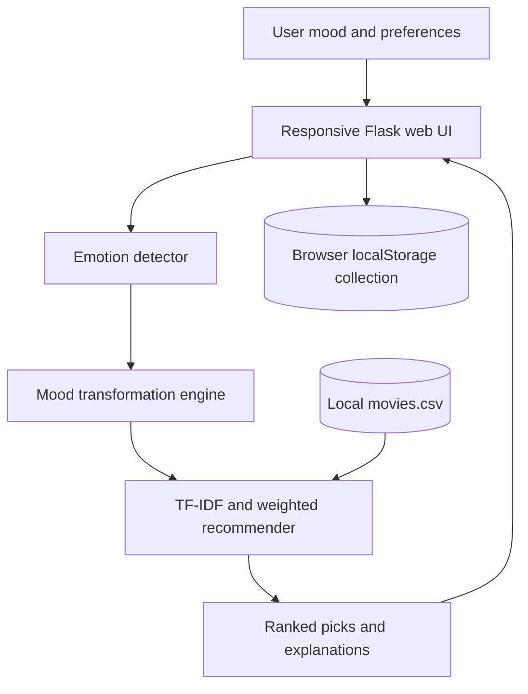

# Afterglow — Mood-Based Movie Recommendations

Afterglow is a Flask application for discovering movies based on a selected mood and viewing preferences. Describe your mood or pick one, then review ranked suggestions and why they matched.

> Mood matching is a discovery aid. It does not promise a particular emotional or mental health outcome.

## What it does

- Detects emotions, relationship and friendship themes, viewing genres, and life situations from short English phrases.
- Supports two-step selection: current feeling plus desired movie experience. Either step can be skipped when the other gives a usable theme.
- Maps the selected intent to a constructive viewing direction and combines it with the desired experience when ranking.
- Ranks the local movie catalog using TF-IDF cosine similarity, mood/theme fit, genre fit, rating, popularity, and optional genre/actor/director preferences.
- Offers genre, theme, language, rating, release year range, runtime, popularity, and derived emotional-tone filters.
- Saves titles to a browser-local collection with localStorage.
- Includes a local SVG favicon, privacy policy, and terms and conditions pages. The legal pages are drafts and contain operator-specific placeholders that must be completed before launch.
- Searches the local movie catalog by title, overview, or genre.
- Uses a configured TMDB API key for title-and-year poster matches when available, otherwise fetches public OMDb poster metadata with the demo key, then falls back to Wikimedia thumbnails. Results are cached during the process and use a local fallback when artwork is unavailable.
- Works without a custom API key. Poster lookup needs an internet connection; recommendations and search still work offline with the local catalog and fallback artwork.
- Includes a JSON recommendation endpoint at `/api/recommend` and a health endpoint at `/health`.

## How recommendations work

The detector normalizes input and checks phrase and synonym matches across moods, themes, genres, and situations. More specific multiword themes take priority over broad words. `mood_engine.py` associates the intent and optional desired experience with a goal, genre affinities, descriptive terms, and content to down-rank. The recommender fits one TF-IDF vectorizer over catalog genres, overviews, keywords, cast, directors, and derived tags at startup. It applies filters without relaxing them and removes duplicate movie IDs. The score is:

```text
score = 0.34 × text similarity
      + 0.19 × mood genre compatibility
      + 0.18 × normalized rating
      + 0.06 × normalized popularity
      + 0.05 × favorite genre match
      + 0.10 × keyword match
      + 0.08 × theme match
```

Explicit user filters apply after scoring. The input does not select a fixed title list; titles are ranked from catalog features. Each result explanation cites matching catalog text/tags and genres. The CSV currently contains 40 titles. Additional `themes`, friendship/relationship tags, tone, inspiration, life-situation, and audience metadata are derived from the existing overview, genres, and keywords when loading the catalog; they are descriptive heuristics, not verified third-party metadata. Content warnings are blank because the current dataset does not supply them. Movie ratings, dates, and descriptions are not generated. Add a larger licensed/verified CSV with the existing columns (and optional richer metadata columns) to expand the catalog; the app remains usable offline.

The homepage groups available selectors into Emotions, Friendship, Love and Relationships, Motivation, Life Situations, Entertainment, and Comfort Movies. Search filters the visible choices. Natural-language examples include “I miss my school friends”, “I feel stressed about my exams”, and “I recently had a breakup and want to move on”.

### Poster lookup and fallback

`services/movie_api.py` first checks TMDB search when `TMDB_API_KEY` is set, matching the catalog title and release year before creating an `image.tmdb.org` poster URL. Without a key or when TMDB is unavailable, it uses the public OMDb demo key to fetch the best available poster for the title and year. If OMDb is unavailable, it queries the Wikipedia Action API and accepts HTTPS Wikimedia thumbnails whose article title plausibly matches. Lookups are cached in process. Poster services may not match every title; if lookup fails or an image cannot load, the app switches to `static/images/poster-fallback.svg` and keeps the title visible. The browser retries a keyless Wikimedia lookup when server-side lookup is unavailable. The CSV `poster_url` column may also contain an HTTPS artwork URL.

## Architecture



Request flow: User Input → NLP → Current Mood → Desired Emotional State → Genre and Keyword Query → Content Similarity + Weighted Ranking → Filters → Recommendations.

## Project structure

```text
app.py
services/       emotion_detector.py, mood_engine.py, recommender.py
data/           movies.csv
templates/      index.html, results.html, search_results.html, privacy.html, terms.html
static/          favicon.svg, css/style.css, js/script.js
tests/           test_emotion.py, test_recommender.py, test_posters.py, test_launch_pages.py
requirements.txt
```

## Requirements and setup

Python 3.10 or newer is recommended.

```bash
python -m venv .venv
# Windows PowerShell:
.venv\Scripts\Activate.ps1
# macOS/Linux: source .venv/bin/activate
pip install -r requirements.txt
```

Copy `.env.example` to `.env` if you want to set a deployment secret. No API key is needed to run the included catalog. Never commit `.env`.

```bash
python app.py
```

Open the local address printed by Flask (usually `http://127.0.0.1:5000`). `FLASK_DEBUG=true` enables the development debugger and should not be used on a public deployment.

## Render deployment

The root-level `render.yaml` defines a free Render web service, installs `requirements.txt`, serves the Flask app with Gunicorn, and checks `/health`. Render generates the production Flask secret and enables secure session cookies. The free plan may spin down when idle; choose a paid plan if that availability is unsuitable.

Deploy the Blueprint in Render, then register a domain you control. `afterglowmovies.com` was unregistered in an RDAP lookup when this candidate was checked, but availability can change and has not been reserved. In the Render service settings, add the registered domain, set the DNS records shown by Render at your domain provider, and verify the domain in Render. Do not treat the candidate as connected until Render confirms verification and HTTPS works.

## Launch checklist

- [ ] Register a domain you control and verify it in Render with working HTTPS. `afterglowmovies.com` is only an unreserved candidate.
- [x] Serve the local favicon at `/static/favicon.svg`.
- [x] Do not display a "Made with AI" badge.
- [x] Add privacy policy and terms and conditions routes at `/privacy` and `/terms`.
- [ ] Complete and review the draft legal pages in `templates/privacy.html` and `templates/terms.html`, including operator identity, contact details, hosting/log retention, jurisdiction, and any applicable legal terms.
- [x] Render Blueprint generates `FLASK_SECRET_KEY` and keeps `FLASK_DEBUG` disabled.

The site stores saved titles in browser local storage and contacts external movie-poster services. See the draft privacy policy for details and items that still need operator confirmation. Do not launch until every unchecked item is complete.

## Example inputs

- “I'm really angry today” → Angry → Calm + refresh
- “I feel low and need something hopeful” → Sad → Comfort + hope
- “I'm stressed because of exams” → Stressed → Unwind + reset
- “I have nothing to do and I'm bored” → Bored → Spark curiosity
- “I'm happy and want something exciting” → Happy → Make a good day even better

## Tests

```bash
python -m unittest discover -s tests -v
```

## Screenshots

Add screenshots of the home and results pages here after running the application.

## Future improvements

- Optional TMDB integration for current metadata, posters, and detail links, with caching and documented attribution.
- Better negation handling, multilingual NLP, and calibrated content tags.
- User accounts and a server-side preference profile.
- Add catalog languages, runtime filtering, and movie type fields as the dataset grows.
- User studies to evaluate whether the explanations and recommendations feel relevant.
